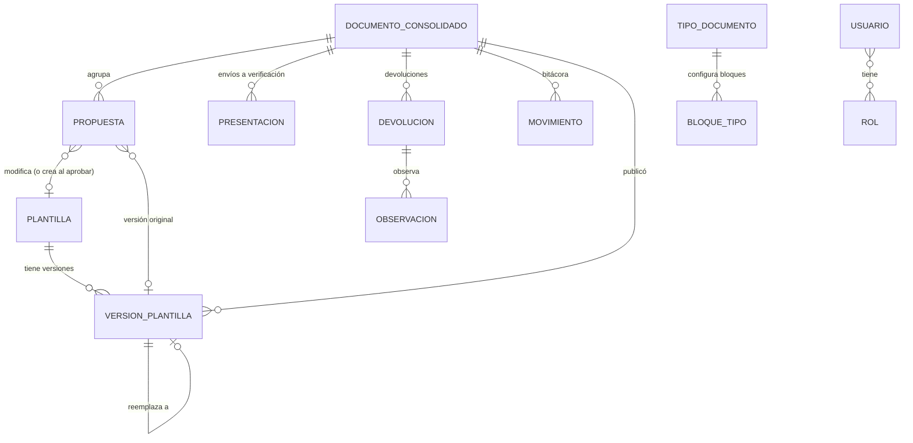
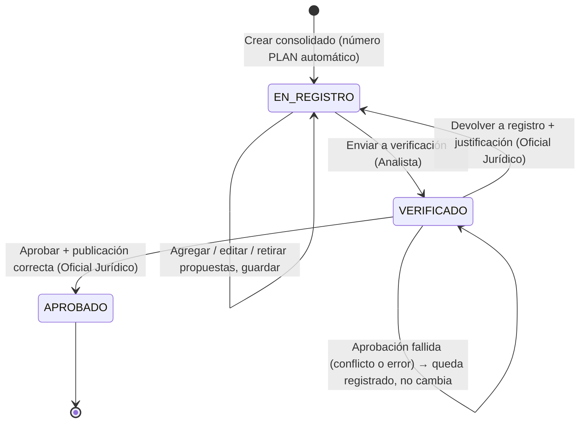

# Documento Consolidado — Fase 1: análisis y diseño funcional

Fecha: 16/10/2026. Estado: **aprobado** (decisiones D1 a D11 tomadas el 16/10/2026). No se ha escrito código de esta funcionalidad.

Este documento analiza el prototipo actual y propone cómo incorporar el **Documento Consolidado** (PLAN-AAAANNNN): un
expediente que agrupa la creación y la modificación de plantillas, pasa por la revisión del Oficial Jurídico y, al
aprobarse, publica los cambios en el consolidado de plantillas vigentes.

La sección [10. Decisiones pendientes](#10-decisiones-pendientes) reúne lo que necesito que usted confirme antes de la
Fase 2.

---

## 1. Diagnóstico del proyecto actual

### 1.1. Qué existe y se puede reutilizar

| Pieza | Estado actual | Uso en el Documento Consolidado |
|---|---|---|
| Arquitectura | Tres capas: `Api` (controladores), `Dominio` (modelos, servicios, validaciones, interfaces de repositorio) e `Infraestructura` (JSON, PDF). El dominio no depende de la infraestructura | Se mantiene. Toda la lógica nueva va en `Dominio`; la API solo expone y valida permisos |
| Almacenamiento | `IRepositorio<T>` sobre JSON (`AlmacenJson`): bloqueo por colección, escritura atómica con `.bak`, cuarentena de archivos dañados, control de concurrencia optimista (`Version`), lote atómico **dentro de una colección** | Se reutiliza. Falta la atomicidad **entre varias colecciones**, que la aprobación necesita (ver 7.3) |
| Identidad de una plantilla | Combinación **Rubro + Sub Rubro + Tipo Documento + Documento** (Original, Modificación, Aclaratoria) | Es la **identidad funcional** que pide la especificación (9.3). No depende del nombre visible |
| Contenido | `Plantilla` (diseño: logo, alineación, pie de página, espacio entre firmas) y `Parrafo` (sección, orden, contenido estructurado TipTap, activo, condición, campos usados), con identificadores estables | Los párrafos con identificador estable permiten comparar por elemento y no por posición |
| Secciones | Enumeración fija: Cabecera, Considerando, Por Tanto, Resuelve, Firmas. El PDF depende de ellas (numeración PRIMERO, SEGUNDO… en Resuelve, títulos) | Corresponden a los **bloques** de la especificación (ver 3.2) |
| Editor | Editor de párrafos con campos dinámicos, tablas, condiciones, duplicar y reordenar | Se reutiliza para editar las **propuestas** |
| PDF | `ServicioDocumento` + MigraDoc, con texto corrido para la Certificación | Se reutiliza para la vista previa de una propuesta y de una versión vigente |
| Historial | `historial.json`: cada creación, modificación y eliminación con el estado anterior y el nuevo, usuario y fecha | Sigue registrando los cambios técnicos. Se agrega una **bitácora del consolidado** con los movimientos del flujo |
| Usuario | Un único usuario de prueba de configuración (`Simulacion:Usuario`). No hay roles ni autenticación | Hay que agregar usuarios de prueba con roles y validar los permisos en el backend |
| Frontend | Angular 22, una sola pantalla (editor), sin enrutador | Se agrega enrutador y las pantallas A–F |
| Pruebas | 156 del backend (xUnit, incluidas pruebas de integración de la API) y 91 del frontend (Vitest) | Se amplían en cada fase |

### 1.2. Qué choca con la especificación

| Comportamiento actual | Regla de la especificación | Consecuencia |
|---|---|---|
| Las plantillas se editan y se guardan directamente | «Las propuestas no modificarán directamente los registros vigentes» (regla 6) | Las plantillas vigentes pasan a ser **de solo lectura**. Todo cambio se hace en una propuesta dentro de un PLAN |
| La Certificación se actualiza sola, de inmediato, con cada guardado de la Resolución (`SincronizadorCopias`) | Nada vigente cambia sin aprobación | La copia se mueve **dentro de la propuesta**: al modificar la Resolución en un PLAN, el sistema prepara también la propuesta de la Certificación (decisión D3) |
| `Plantilla.Estado` (Borrador / Publicada) | Vigencia VIGENTE / NO VIGENTE, distinta del estado del consolidado | `Estado` se reemplaza por la vigencia de cada versión |
| El contenido vive en una sola copia que se sobrescribe | Conservar la versión anterior, sin eliminarla físicamente (regla 15) | Cada publicación crea una **versión** inmutable |
| Tipos: Constancia de Registro, Dictamen, Resolución, Certificación | Resoluciones, Certificaciones, Dictámenes, **Constancias de Obligados Tributarios** | Falta confirmar si «Constancia de Registro» es la misma (decisión D1) |
| Proyecto en .NET 9 | «.NET 8 o la versión institucionalmente aprobada» | El soporte de .NET 9 termina el 10/11/2026. Recomiendo pasar a .NET 10 (LTS) (decisión D9) |

---

## 2. Arquitectura propuesta

Se mantiene la arquitectura por capas actual, con la regla de que **la lógica de negocio vive solo en `Dominio`**:

```
Angular (pantallas A–F)
   │  HTTP + encabezado de usuario de prueba
   ▼
Api ── controladores delgados; filtro de permisos por rol (backend)
   │
   ▼
Dominio
   ├── Consolidado/   ServicioConsolidados (estados y transiciones), ServicioPropuestas,
   │                  NumeradorPlan, ComparadorContenido, ServicioPublicacion, Bitácora
   ├── Seguridad/     IUsuarioActual (usuario + roles), Permisos
   ├── Servicios/     (existentes) párrafos, campos, logos, historial
   └── Repositorios/  IRepositorio<T>, IUnidadDeTrabajo  ← nuevo
   │
   ▼
Infraestructura
   ├── Json/  RepositorioJson<T>, AlmacenJson + UnidadDeTrabajoJson (diario de transacción)
   └── Pdf/   GeneradorPdfMigraDoc
```

- **`IUnidadDeTrabajo`** es la pieza nueva que hace posible la publicación transaccional. Con JSON se implementa con un
  diario (7.3). Con una base de datos real será una transacción del motor, sin cambiar el dominio.
- **Permisos en el backend**: cada operación del dominio exige un permiso (`Consolidado.Crear`, `Consolidado.Aprobar`,
  etc.). La API devuelve 403 si el usuario no lo tiene. El frontend oculta las acciones, pero eso no sustituye la
  validación del servidor.
- **Usuarios de prueba**: colección `usuarios.json` con roles. El frontend elige el usuario con un selector visible
  «Usuario de prueba» y lo envía en un encabezado. Esto es **solo para el prototipo**: no es autenticación. En
  producción se reemplaza por el proveedor de identidad institucional, implementando `IUsuarioActual`.

---

## 3. Modelo de datos lógico

### 3.1. Entidades y relaciones



| Entidad (colección JSON) | Campos principales | Notas |
|---|---|---|
| **Plantilla** (`plantillas`) — identidad | `Id`, `Codigo` (p. ej. `PLT-0001`), `RubroId`, `SubRubroId`, `TipoDocumentoId`, `ClaseDocumentoId`, `Nombre`, `FechaCreacion`, `ConsolidadoCreacionId` | Ya no guarda contenido. Una identidad funcional = una plantilla. Se crea solo al aprobar una operación CREAR |
| **VersionPlantilla** (`versionesPlantilla`) | `Id`, `PlantillaId`, `NumeroVersion` (1, 2, 3…), `Vigencia` (`Vigente` / `NoVigente`), `Contenido` (diseño + bloques + párrafos, ver 3.3), `Huella` (SHA-256 del contenido), `VersionAnteriorId`, `ConsolidadoId`, `PublicadaPor`, `FechaPublicacion`, `InicioVigencia`, `FinVigencia` | **Inmutable** salvo los campos de vigencia. Nunca se elimina |
| **DocumentoConsolidado** (`consolidados`) | `Id`, `Numero` (`PLAN-20260001`), `Anio`, `Secuencia`, `Estado` (`EnRegistro` / `Verificado` / `Aprobado`), `AnalistaId`, `FechaCreacion`, `NumeroPresentacion` (1, 2…), `FechaEnvio`, `EnviadoPor`, `RevisorId`, `FechaRevision`, `AprobadorId`, `FechaAprobacion`, `FechaActualizacion` | Los resúmenes (tipos afectados, cantidades) **se calculan** de las propuestas, no se escriben a mano (regla 4) |
| **Propuesta** (`propuestas`) | `Id`, `ConsolidadoId`, `Operacion` (`Crear` / `Modificar`), identidad funcional (Rubro, Sub Rubro, Tipo, Documento), `Nombre`, `PlantillaId` (solo MODIFICAR), `VersionOrigenId` + `HuellaOrigen` (fotografía de la versión original), `ContenidoPropuesto`, `DerivadaDePropuestaId` (Certificación derivada, D3), `Retirada` + `MotivoRetiro` | Una plantilla aparece **una sola vez** por consolidado: todos sus bloques modificados van en la misma propuesta (sección 4 de la especificación) |
| **Presentacion** (`presentaciones`) | `Id`, `ConsolidadoId`, `Numero`, `Usuario`, `Fecha`, `CantidadPlantillas`, `Resumen` (tipos y cambios), `HuellaIntegridad` (SHA-256 de todas las propuestas enviadas), `ContenidoEnviado` (copia congelada de cada propuesta) | Permite reconstruir exactamente qué se envió en cada presentación |
| **Devolucion** (`devoluciones`) | `Id`, `ConsolidadoId`, `NumeroPresentacion`, `Usuario`, `Fecha`, `Justificacion` (obligatoria), `Observaciones[]`: `PropuestaId`, `BloqueCodigo` (opcional), `ParrafoId` (opcional), `Problema`, `Recomendacion` | Solo se agregan; nunca se sobrescriben (sección 8) |
| **Movimiento** (`movimientos`) — bitácora | `Id`, `ConsolidadoId`, `Tipo` (Creación, PropuestaAgregada, PropuestaEditada, PropuestaRetirada, EnvioVerificacion, Devolucion, Aprobacion, Publicacion, CambioVigencia, ErrorPublicacion), `Usuario`, `Fecha`, `EstadoOrigen`, `EstadoDestino`, `NumeroPresentacion`, `Detalle` | Solo lectura para todos los usuarios ordinarios. Es la línea de tiempo que pide la sección 8 |
| **BloqueDocumental** (`bloques`) y **BloqueTipo** | Bloque: `Codigo` (CABECERA, CONSIDERANDO…), `Nombre`. Por tipo: `TipoDocumentoId`, `BloqueCodigo`, `Orden`, `Obligatorio`, `TipoContenido` | Catálogo configurable por tipo documental (sección 6). Ver 3.2 |
| **Usuario** / **Rol** (`usuarios`) | `Id`, `Nombre`, `Roles` (`Analista`, `OficialJuridico`, `Administrador`) | Solo para simular en el prototipo |
| **RegistroHistorial** (existente) | Sin cambios | Sigue guardando cada cambio técnico con su estado anterior y nuevo |

### 3.2. Bloques: cómo encajan las secciones actuales

La especificación llama **bloque** a lo que hoy es una **sección** (Cabecera, Considerando, Por Tanto, Resuelve, Firmas).
Dentro de cada bloque, el contenido son **párrafos**: cada uno con identificador estable, texto con formato, campos
dinámicos, tablas y condición. A esto se suma el **diseño** del documento (logo, pie de página, espacio entre firmas),
que se trata como un bloque especial `DISEÑO`.

- **Propuesta:** en la primera entrega, el catálogo de bloques se carga con las cinco secciones actuales, con un código
  estable para cada una. Los bloques adicionales (VISTOS, ANTECEDENTES, FUNDAMENTACIÓN LEGAL, SELLOS…) quedan como
  catálogo **configurable por tipo documental**.
- **Advertencia:** hoy la sección es una enumeración fija y el PDF la usa en 10 lugares, por ejemplo para la numeración
  PRIMERO, SEGUNDO… de Resuelve. Pasar a bloques configurables obliga a mover esas reglas al catálogo, por ejemplo
  «este bloque numera sus párrafos». Recomiendo hacerlo en la Fase 4, no antes (decisión D2).
- La especificación pide que cada bloque tenga contenido, obligatoriedad, estado de inclusión y versión original y
  propuesta. En este diseño, la versión original y la propuesta no se guardan por bloque, sino en el contenido de la
  `VersionPlantilla` original y en el `ContenidoPropuesto` de la propuesta. La comparación las relaciona por código de
  bloque e identificador de párrafo.

### 3.3. Forma del contenido (versión y propuesta)

El contenido de una versión vigente y el de una propuesta tienen **la misma forma**. Eso permite comparar, generar el
PDF y publicar con el mismo código:

```json
{
  "diseno": { "logoId": "ARC-…", "alineacionLogo": "Centro", "piePagina": "…", "espacioFirmasCm": 1.2 },
  "bloques": [
    {
      "codigo": "CONSIDERANDO", "incluido": true,
      "parrafos": [
        { "id": "PAR-004", "orden": 1, "contenido": { "type": "doc", "content": [ … ] },
          "activo": true, "mostrarSoloSiCumple": false, "condicion": null }
      ]
    }
  ]
}
```

- Al **publicar**, el contenido se congela dentro de `VersionPlantilla`: una versión es un solo registro inmutable.
- Para **editar** una propuesta se reutiliza el editor actual. Los párrafos de trabajo se guardan en la colección
  `parrafos`, ligados a la **propuesta** en vez de a la plantilla. Al enviar a verificación se congelan en la
  presentación. Así no hay que rehacer el editor, y la versión vigente nunca se toca.
- Al iniciar una operación MODIFICAR, los párrafos de la versión vigente se copian a la propuesta **conservando sus
  identificadores**. Los párrafos nuevos reciben identificadores nuevos. Esto es lo que permite que la comparación no
  dependa de la posición.

### 3.4. Migración de los datos actuales

Las cuatro plantillas de prueba (PLA-001 a PLA-004) y sus párrafos pasan a ser **versión 1 VIGENTE**, marcadas como
«Carga inicial» y sin consolidado de origen. El historial actual se conserva (decisión D5).

---

## 4. Estados y transiciones



| Transición | Quién | Validaciones (backend) | Registra |
|---|---|---|---|
| Crear | Analista | — | Número PLAN, movimiento «Creación» |
| Agregar / editar / retirar propuesta | Analista responsable | Estado = EN REGISTRO. Plantilla no incluida ya en este u otro consolidado abierto (D4). CREAR: no existe plantilla vigente con esa identidad funcional | Movimiento + historial del cambio |
| Enviar a verificación | Analista responsable | Estado = EN REGISTRO. Al menos una propuesta no retirada. Cada propuesta válida (bloques obligatorios presentes, párrafos válidos). Ninguna propuesta MODIFICAR desactualizada | `Presentacion` congelada con huella de integridad. Estado → VERIFICADO. Movimiento |
| Devolver a registro | Oficial Jurídico | Estado = VERIFICADO. Justificación obligatoria (mínimo de caracteres). No puede ser el analista del consolidado | `Devolucion` con observaciones. Estado → EN REGISTRO. Movimiento |
| Aprobar | Oficial Jurídico | Estado = VERIFICADO. No es el analista que lo preparó ni quien lo envió. Huella actual = huella enviada (nadie alteró la propuesta). Por cada MODIFICAR: la versión vigente sigue siendo `VersionOrigenId`. Por cada CREAR: sigue sin existir otra vigente con esa identidad. Unicidad: como máximo una vigente por identidad | Publicación transaccional (7). Estado → APROBADO solo si la publicación terminó. Movimientos de aprobación, publicación y cambio de vigencia |

- **VERIFICADO** significa, según la especificación, «enviado y pendiente de la revisión del Oficial Jurídico», no «ya
  revisado». En pantalla se mostrará «VERIFICADO · pendiente de revisión jurídica» para evitar confusiones (D6).
- Una vez **APROBADO**, el consolidado no admite cambios. Nuevos ajustes requieren un PLAN nuevo.
- **Retirar** una propuesta es una eliminación lógica: queda en la bitácora con su motivo.

---

## 5. Numeración PLAN-AAAANNNN

- Se genera **solo en el servidor**, en la misma operación atómica que crea el consolidado. Dentro del bloqueo de la
  colección `consolidados` se toma la secuencia más alta del año en curso y se le suma 1. Dos creaciones simultáneas no
  pueden obtener el mismo número.
- El año sale de la fecha del servidor en la zona horaria institucional, que es configurable. Así un consolidado creado
  la noche del 31 de diciembre no toma el año siguiente por usar UTC.
- La secuencia se **reinicia cada año** (PLAN-20270001). Los documentos anteriores conservan su número.
- Si la secuencia supera 9999 en un año, se rechaza la creación con un mensaje claro; el formato de 4 dígitos es fijo.
- El número no se reutiliza: los consolidados no se eliminan físicamente.
- Con base de datos: una tabla de secuencias por año o un `SEQUENCE` por año, dentro de la misma transacción.

---

## 6. Comparación de contenido (revisión jurídica)

La comparación la calcula el **servidor** (`ComparadorContenido`), para que el analista y el Oficial Jurídico vean
exactamente lo mismo y quede probada con pruebas automáticas.

1. **Emparejar bloques por código** (CABECERA, CONSIDERANDO…), no por nombre ni posición. Un bloque solo en la
   propuesta es **BLOQUE NUEVO**; uno que falta o se excluyó es **BLOQUE ELIMINADO**.
2. **Emparejar párrafos por identificador estable** dentro de cada bloque:
   - solo en la propuesta → **agregado**;
   - solo en el original → **eliminado**;
   - en ambos con contenido distinto → **modificado**: diferencia de texto palabra por palabra, que distingue lo agregado,
     lo eliminado y lo sustituido;
   - en ambos con distinta posición relativa → **movido** (cambio de orden);
   - cambios en activo, condición o «mostrar solo si cumple» → se muestran aparte como cambios de configuración.
3. **Texto comparable**: el contenido TipTap se convierte a texto. Los campos dinámicos aparecen como su etiqueta
   (`{Beneficiario}`) y las tablas, fila por fila. Si solo cambia el formato (negrita, alineación), se marca como
   «cambio de formato» aunque el texto sea igual.
4. **Diseño** (logo, pie de página, espacio entre firmas): se compara campo por campo como el bloque `DISEÑO`.
5. **Resultado** por propuesta: bloques con estado (Modificado, Sin cambios, Nuevo, Eliminado), párrafos con sus
   diferencias y totales. Ese resultado alimenta la pantalla D y el resumen de tipos documentales.

Algoritmo de diferencias: comparación por palabras con el método de la subsecuencia común más larga (Myers), propio o
con una biblioteca de licencia MIT. Se elegirá en la Fase 4, revisando la licencia, como se hizo con MigraDoc.

**Ajustes de una plantilla** (D8, decidido):

- En el resumen, cada plantilla aparece **una sola vez** como un ajuste a esa plantilla. Ejemplo: «Resolución —
  Modificar — 1 plantilla — 4 ajustes». No hay una fila por cada cambio.
- La columna «Cambios» cuenta los **ajustes**. Suma 1 cada párrafo agregado, eliminado, modificado o movido, cada
  cambio de configuración de un párrafo (activo, condición) y cada dato de diseño cambiado (logo, pie de página,
  espacio entre firmas).
- Cada ajuste es **visible por separado** para el Oficial Jurídico, con una etiqueta que dice qué se hizo y dónde.
  Ejemplos: «NUEVO CONSIDERANDO», «CONSIDERANDO 3 modificado», «RESUELVE: SEGUNDO eliminado», «POR TANTO 1 movido a
  la posición 2», «Pie de página modificado». La numeración de la etiqueta es la de la propuesta. Para un párrafo
  eliminado, se usa la del original.
- En la pantalla D, la lista de ajustes de la plantilla seleccionada sirve de índice: al elegir un ajuste, ambos
  paneles saltan a ese bloque y párrafo.

---

## 7. Publicación y vigencia

### 7.1. Al aprobar una MODIFICACIÓN

1. Se confirma que la versión vigente sigue siendo `VersionOrigenId`. Si alguien publicó otra versión después, hay
   **conflicto**: no se aprueba nada y se registra.
2. La versión original pasa a **NO VIGENTE** (`FinVigencia` = ahora).
3. Se crea la nueva `VersionPlantilla` **VIGENTE** con `NumeroVersion + 1`, `VersionAnteriorId`, `ConsolidadoId`,
   publicador y fecha.

### 7.2. Al aprobar una CREACIÓN

1. Se confirma que sigue sin existir una plantilla vigente con la misma identidad funcional.
2. Se crea la `Plantilla` (identidad) y su versión 1 **VIGENTE**. Ninguna otra versión cambia.

### 7.3. Transacción con archivos JSON

La aprobación escribe en varias colecciones: `versionesPlantilla`, `plantillas`, `consolidados`, `movimientos` e
`historial`. Hoy el almacenamiento solo garantiza la atomicidad dentro de una colección. Se propone
**`UnidadDeTrabajoJson`**:

1. Toma los bloqueos de todas las colecciones involucradas, **siempre en el mismo orden** (evita bloqueos cruzados).
2. Lee, aplica todos los cambios en memoria y valida (unicidad de vigencia, versiones y huellas).
3. Escribe un **diario** (`transacciones/<id>.json`) con el contenido final de cada colección y el estado «preparada».
4. Reemplaza cada archivo de forma atómica, como ya se hace hoy, y marca el diario «completada».
5. Si el proceso se interrumpe entre los pasos 3 y 4, al reiniciar se **completa** la transacción desde el diario.
   Si algo falla antes del paso 3, ningún archivo cambió.

Resultado: no puede quedar la versión anterior NO VIGENTE sin la nueva publicada, ni el consolidado APROBADO sin sus
versiones. Un error de publicación se registra en la bitácora (`ErrorPublicacion`) y el consolidado queda VERIFICADO.

**Límite honesto:** esto protege contra escrituras simultáneas **dentro de un solo proceso** de la API y contra
interrupciones. **No es una solución de producción**: varios servidores escribiendo los mismos archivos no están
protegidos. En producción, la publicación será una transacción de la base de datos (Fase 8).

### 7.4. Unicidad de vigencia

Regla: como máximo una versión VIGENTE por plantilla, y una plantilla por identidad funcional. Se valida en tres
lugares: al agregar una propuesta, al enviar y, de nuevo, **dentro de la transacción** de aprobación. Si se detectan
dos vigentes para una misma identidad (datos dañados o editados a mano), se bloquea la publicación y se informa la
inconsistencia al administrador. Con base de datos se refuerza con un índice único filtrado (`WHERE Vigencia = 'Vigente'`).

### 7.5. La Certificación dentro del flujo

Para conservar lo construido (la Certificación sigue a la Resolución), propongo (D3):

- Al agregar o editar una propuesta de **Resolución**, el sistema crea o actualiza **en el mismo consolidado** la
  propuesta derivada de la **Certificación** de la misma combinación, con las reglas de hoy (dato por dato, cambio de
  «resolución» por «certificación», lo editado en la Certificación se conserva hasta que la Resolución cambie lo
  mismo).
- El analista puede editar la propuesta de la Certificación. Ambas se revisan y se publican juntas.
- Nada de esto toca las versiones vigentes hasta la aprobación.

---

## 8. Roles y permisos

| Acción | Analista | Oficial Jurídico | Administrador |
|---|:-:|:-:|:-:|
| Crear consolidado, agregar y editar propuestas (EN REGISTRO, propio) | ✅ | — | — |
| Enviar a verificación (propio) | ✅ | — | — |
| Ver bandeja de VERIFICADOS, comparar, ver historial | — | ✅ | ✅ consulta |
| Ver sus propios consolidados EN REGISTRO (incluidos los devueltos) | ✅ solo los suyos | — | ✅ consulta |
| Devolver a registro (con justificación) | — | ✅ | — |
| Aprobar | — | ✅ (nunca uno que preparó o envió) | — |
| Consultar consolidado vigente y versiones anteriores | ✅ | ✅ | ✅ |
| Catálogos, tipos documentales, bloques, usuarios y roles, numeración | — | — | ✅ |
| Modificar directamente una plantilla vigente | — | — | — (nadie) |

- El Oficial Jurídico **no edita** propuestas: si algo debe cambiar, devuelve el consolidado.
- Separación de funciones: aunque un usuario de prueba tenga dos roles, el servidor impide que apruebe su propio
  consolidado.
- **Visibilidad por bandeja** (D6 y D10, decididos):
  - Cada analista ve **solo los consolidados que él creó**. No ve los de otros analistas, ni en consulta. El servidor
    filtra el listado y rechaza (404) abrir un consolidado ajeno, aunque se conozca su número.
  - Al **enviar a verificación**, el consolidado **sale de la bandeja del analista** y aparece solo en la bandeja del
    Oficial Jurídico.
  - Al **devolverlo**, vuelve a la bandeja de su analista (EN REGISTRO), con las observaciones.
  - Los consolidados **APROBADOS** de cada analista quedan en su consulta de históricos, de solo lectura, para que
    pueda ver sus aprobaciones.
  - El administrador puede consultar todos y **reasignar** un consolidado EN REGISTRO a otro analista (por ejemplo,
    por ausencia). La reasignación queda en la bitácora.

---

## 9. Diseño preliminar de pantallas

Se agrega un enrutador. Arriba, el selector «Usuario de prueba» y la insignia «Prototipo · datos de prueba». Los
**estados del consolidado** (EN REGISTRO, VERIFICADO, APROBADO) y la **vigencia** (VIGENTE, NO VIGENTE) usan formas y
colores distintos, para no confundirlos (regla 19).

**A. Documentos Consolidados** (`/consolidados`)

```
┌ Documentos consolidados ───────────────────────────────── [+ Nuevo consolidado] ┐
│ Número [____]  Año [2026▾]  Estado [Todos▾]  Analista [▾]  Tipo [▾]  Fecha [__] │
├─────────────┬──────────┬──────────┬──────────────────────┬────┬──────────┬──────┤
│ Número      │ Creación │ Analista │ Tipos incluidos      │Plt.│ Estado   │ Acc. │
│ PLAN-2026…1 │ 16/10/26 │ a.perez  │ Resolución, Dictamen │ 3  │EN REGISTRO│ Abrir│
│ PLAN-2026…2 │ 15/10/26 │ m.lopez  │ Certificación        │ 1  │VERIFICADO│Revisar│
└─────────────┴──────────┴──────────┴──────────────────────┴────┴──────────┴──────┘
```

**B. Registro del consolidado** (`/consolidados/:id`)

```
┌ PLAN-20260001 · EN REGISTRO · Analista a.perez · creado 16/10/2026 ─────────────┐
│ ⚠ Devuelto el 17/10 por j.ramos: «El considerando 3 cita un artículo derogado» │
│ Tipos de documento incluidos                                                    │
│  Tipo           Operación  Plantillas  Cambios                                  │
│  Resolución     Modificar      1          4      ▸ ver                          │
│  Certificación  Modificar      1          4      ▸ ver (derivada)               │
│  Dictamen       Crear          1          3      ▸ ver                          │
│ [CREAR PLANTILLA] [MODIFICAR PLANTILLA]                                         │
│ Propuestas: tarjeta por plantilla → Editar · Vista previa PDF · Diferencias · Retirar │
│                                         [GUARDAR] [ENVIAR A VERIFICACIÓN]       │
└─────────────────────────────────────────────────────────────────────────────────┘
```

«Editar» abre el editor actual (pestañas por bloque, campos, condiciones) sobre la propuesta.

**C. Selección de plantilla** (diálogo)
- CREAR: Tipo documental, Rubro, Sub Rubro, Documento y nombre. Avisa si ya existe una vigente con esa identidad.
- MODIFICAR: catálogo de vigentes con búsqueda: código, tipo, combinación, versión vigente y fecha. Las que ya están en
  otro consolidado abierto aparecen deshabilitadas, con el número de ese PLAN.

**D. Revisión jurídica** (`/revision/:id`)

```
┌ PLAN-20260001 · VERIFICADO · pendiente de revisión · Analista a.perez · 2.ª presentación ┐
├ Plantillas ───────────┬ ORIGINAL (vigente v3) ─────────┬ PROPUESTA ────────────────────┤
│ ● Resolución  Modif. 3│ CONSIDERANDO                   │ CONSIDERANDO                  │
│   CABECERA   Modif.   │ Que el monto ~~asciende a~~    │ Que el monto __alcanza__      │
│   CONSIDERANDO Modif. │ L 10,000…                      │ L 10,000…                     │
│   POR TANTO  Sin camb.│ (párrafo eliminado) ▓▓▓▓       │ ── BLOQUE NUEVO: VISTOS ──    │
│   RESUELVE   Modif.   │                                │ ↕ movido de la posición 2 a 4 │
│ ○ Certificación Modif.│                                │                               │
│ ○ Dictamen    Crear   │ NUEVA PLANTILLA                │ …                             │
├───────────────────────┴────────────────────────────────┴───────────────────────────────┤
│ Historial de observaciones ▸     [DEVOLVER A REGISTRO]                    [APROBAR]    │
└──────────────────────────────────────────────────────────────────────────────────────┘
```

- Las columnas «Original» y «Propuesta» se desplazan **sincronizadas**, bloque contra bloque.
- Los bloques sin cambios aparecen plegados, con opción de desplegarlos.
- En pantallas angostas, los dos paneles se apilan, con un selector «Original / Propuesta / Ambos».

**E. Confirmación de devolución** (diálogo): justificación general (obligatoria) y observaciones repetibles (plantilla,
bloque opcional, problema, recomendación). Antes de devolver, se pide confirmación final.

**F. Consolidado de plantillas** (`/vigentes`): plantillas con su vigencia y versión vigente. Desde cada una se
consultan las versiones anteriores (contenido, PDF, comparación entre versiones) y el PLAN que originó cada publicación.

---

## 10. Decisiones pendientes

| # | Tema | Decisión o recomendación |
|---|---|---|
| D1 | ¿«Constancia de Registro» es la «Constancia de Obligados Tributarios»? | ✅ **Decidido:** es la misma; se renombra a «Constancia de Obligados Tributarios» |
| D2 | Bloques configurables por tipo documental | ✅ **Decidido:** en las fases 2 y 3 se usan con las 5 secciones actuales; bloques adicionales y reglas de PDF configurables en la Fase 4 |
| D3 | Certificación ligada a la Resolución | ✅ **Decidido:** van juntas. Propuesta derivada en el mismo consolidado, editable, publicada junto con la Resolución (7.5) |
| D4 | ¿Una plantilla puede estar en dos consolidados abiertos a la vez? | ✅ **Decidido: no.** Se bloquea mientras otro PLAN no aprobado la incluya. Evita la mayoría de los conflictos; el control de versión al aprobar sigue existiendo |
| D5 | Datos actuales | ✅ **Decidido:** PLA-001 a PLA-004 pasan a versión 1 VIGENTE «Carga inicial» |
| D6 | Estado VERIFICADO | ✅ **Decidido:** se mantiene el nombre, con la etiqueta «pendiente de revisión jurídica». Al pasar a VERIFICADO sale de la bandeja del analista y solo aparece en la del Oficial Jurídico (sección 8) |
| D7 | Entrada en vigencia | ✅ **Decidido:** inmediata al aprobar |
| D8 | Definición de «cambios» en el resumen | ✅ **Decidido:** una fila por plantilla, como un ajuste a esa plantilla. Cada ajuste («NUEVO CONSIDERANDO», «CONSIDERANDO 3 modificado»…) cuenta 1 y se muestra por separado al Oficial Jurídico (sección 6) |
| D9 | Versión de .NET | ✅ **Decidido:** pasar a **.NET 10 (LTS)** antes de la Fase 2. Requiere instalar el SDK de .NET 10 (hoy solo está el 9.0.300) (solo cambia `TargetFramework`, con todas las pruebas). .NET 9 deja de tener soporte el 10/11/2026 |
| D10 | ¿Un analista ve consolidados de otros? | ✅ **Decidido:** no. Cada analista ve solo los suyos. El administrador puede reasignar (sección 8) |
| D11 | Editor actual (edición directa) | ✅ **Decidido:** desaparece como pantalla independiente: solo se edita dentro de una propuesta. La vista de una plantilla vigente es de solo lectura, con PDF |

---

## 11. Plan de fases (ajustado al proyecto)

| Fase | Contenido | Criterio de aceptación |
|---|---|---|
| **1** | Este documento | **Aprobado ✅** (16/10/2026), con las decisiones D1 a D11 |
| 2 | Modelo JSON: nuevas colecciones y datos semilla (versiones vigentes y no vigentes, consolidados en los tres estados, devoluciones, bitácora), migración (D5), `IUnidadDeTrabajo` con diario, usuarios de prueba y permisos en el backend | Pruebas de numeración concurrente, transacción con fallo simulado (no quedan cambios parciales) y permisos |
| 3 | Consolidado: crear, numerar, CREAR y MODIFICAR, editor sobre la propuesta, listado único de tipos, pantallas A, B y C | Un analista arma un PLAN con varias plantillas sin tocar ninguna vigente |
| 4 | Comparador y bloques configurables (D2); vista de diferencias para el analista | Pruebas de comparación: agregado, eliminado, sustituido, movido, bloque nuevo y eliminado, formato y diseño |
| 5 | Envío, bandeja del Oficial Jurídico, pantallas D y E, devoluciones con observaciones, varias presentaciones | Ciclo enviar → devolver → corregir → reenviar con historial completo |
| 6 | Aprobación, publicación transaccional, vigencia, pantalla F | Aprobación de un PLAN con varias plantillas; conflicto detectado; ningún cambio parcial ante un error |
| 7 | Auditoría y pruebas transversales (permisos, concurrencia, recuperación) | Reglas 1 a 20 cubiertas por pruebas |
| 8 | Estrategia de base de datos: esquema, índices únicos de vigencia, secuencias y transacciones; implementación de `IRepositorio` e `IUnidadDeTrabajo` | Documento aprobado; el dominio no cambia |
